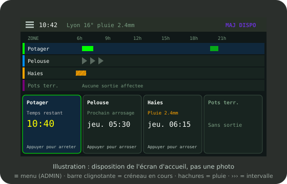

# 2. L'écran tactile

L'écran du module montre d'un coup d'œil l'état du jardin et permet
d'arroser à la main. Les réglages détaillés se font dans les pages Web
(chapitre 6).

L'écran n'affiche pas d'accents : les libellés cités ici sont écrits comme
à l'écran (« Systeme », « Arreter »).

## L'écran d'accueil

*Illustration (pas une photo) : disposition de l'accueil avec 4 zones.*
`[capture : photo de l'écran d'accueil, à ajouter]`

On y trouve :

- **le bandeau du haut** : bouton de menu (coin supérieur gauche), heure,
  météo, état du Wi-Fi et, s'il y a lieu, la mention « MAJ DISPO » (en
  violet) quand une mise à jour attend ;
- **le planning** des zones : une ligne par zone avec les créneaux du jour.
  La barre du créneau qui arrose en ce moment **clignote** ;
- **un bouton par zone** : il indique le prochain arrosage (« Prochain
  arrosage ») ou le temps restant (« Temps restant ») et, en bas, « Appuyer
  pour arroser » ou « Appuyer pour arreter ».

Avec **plus de 4 zones**, l'accueil passe d'une vue à l'autre par un bouton
en bas d'écran : le planning d'un côté, la « Marche forcee » (une rangée par
zone, pour arroser ou arrêter) de l'autre.

Les mêmes repères que dans les pages Web s'appliquent au planning :

- **hachures** : arrosage prévu mais annulé par la pluie, ou zone sans sortie
  raccordée ;
- **chevrons** (›››) : jour sans arrosage d'une zone en mode intervalle ; ils
  pointent vers le prochain jour arrosé.

## L'écran d'une zone

Touchez la ligne d'une zone dans le planning : son écran s'ouvre. Il
indique :

- l'état : « ARRET », « ARROSAGE EN COURS » (avec le temps écoulé et le
  temps restant), ou « SANS SORTIE AFFECTEE » si aucune vanne n'est
  raccordée à cette zone ;
- la dernière décision du planning, par exemple « Planifie », « Jour non
  prevu » ou « Pluie 3.2mm » ;
- un grand bouton « Arroser 10min » ou « Arreter », et « Retour » vers
  l'accueil.

`[capture : écran d'une zone]`

Après un démarrage ou un arrêt, l'écran **revient seul à l'accueil**, où le
temps restant se met à jour chaque seconde.

## Le code PIN

Si un code PIN est posé (4 à 6 chiffres), il est demandé :

- pour ouvrir le menu d'administration (« ADMIN ») ;
- pour lancer un arrosage depuis l'écran.

Une fois saisi, l'écran reste déverrouillé **5 minutes**. Après plusieurs
codes faux, l'écran impose une attente qui s'allonge à chaque erreur (jusqu'à
15 minutes, même après un redémarrage).

`[capture : pavé de saisie du PIN]`

**Poser, changer ou retirer le PIN :** ADMIN > « Securite » (« Poser un
PIN », « Retirer le PIN »).

**PIN oublié :** coupez l'alimentation, rebranchez, puis **maintenez le doigt
sur l'écran pendant 10 secondes** au démarrage : le PIN est effacé.

## Le menu d'administration (ADMIN)

Touchez le **coin supérieur gauche** de l'accueil. Le menu se parcourt page
par page avec les flèches en bas de l'écran ; la flèche en haut à gauche
ramène à l'accueil.

| Page | Contenu |
|---|---|
| « WiFi » | réseau actuel, adresse du module (`http://…` et nom `.local`), « Lancer portail captif » pour changer de réseau |
| « NTP » | source de l'heure |
| « Meteo » | ville ou coordonnées utilisées pour les prévisions |
| « Zones » | durée maximale (« Duree max ») et durée de l'arrosage manuel (« Duree manuel ») |
| « Systeme » | adresse, mémoire, temps de fonctionnement ; « Regler l'ecran » ; autorisation du mot de passe Web |
| « Logs » | derniers messages du module |
| « Sante » | bilan de l'état du module (voir ci-dessous) |
| « A propos » | version du programme et des pages Web |
| « Securite » | code PIN |
| « En ligne » | rattachement du module à un compte en ligne (chapitre 10) |

`[capture : menu ADMIN, page WiFi]`

## La page Santé et les alarmes

Quand quelque chose sort de l'ordinaire (carte SD absente, défaut de
raccordement, panne de synchronisation…), le bandeau du haut le signale.
**Touchez le bandeau** : la page « Sante » s'ouvre et dit ce qui ne va pas.
« Retour » ramène là où vous étiez.

Le détail des alarmes et de la conduite à tenir est au chapitre 13.

## La veille

L'écran s'éteint après 5 minutes sans toucher (réglable dans les pages Web,
Paramètres > « Options avancées du module » > « Système », « Veille ecran » ;
0 = jamais). Un toucher le rallume ; ce premier toucher ne déclenche rien.
Un arrosage qui démarre rallume aussi l'écran.

## Pendant une mise à jour

L'écran devient **violet** et affiche les étapes et une barre de progression.
**Ne débranchez pas le module.** Il redémarre seul à la fin.
