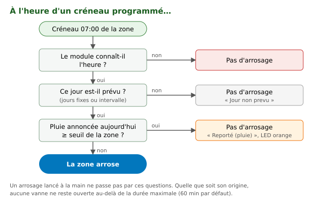

# 4. Pluie et météo

AquaLook consulte les prévisions et **annule l'arrosage programmé du jour**
quand la pluie annoncée suffit. Sans Internet, il arrose normalement selon
le planning.

## Régler la météo

« Paramètres » > « Options avancées du module » > « Météo » :

| Réglage | Choix |
|---|---|
| « Source des prévisions » | « Open-Meteo — modèles Météo-France » (sans inscription) ou « OpenWeatherMap » (demande une « Clé API OpenWeatherMap », gratuite sur leur site) |
| « Localisation » | « Ville / Pays » (par exemple Toulouse, FR) ou « Coordonnées GPS » (latitude, longitude : plus précis à la campagne) |
| « Unités » | « Métrique (°C) » ou « Impérial (°F) » |

Le module relit les prévisions **toutes les 2 heures** (une minute plus tard
en cas d'échec). Il connaît les **5 prochains jours**.

## Comment la pluie annule un arrosage

Chaque zone a son **seuil de pluie** (« Seuil pluie (mm) », 2 mm par
défaut, réglable de 0 à 50 mm dans « Config -- <zone> », chapitre 3) :

- au moment d'un créneau programmé, le module regarde la **pluie annoncée
  pour la journée en cours** ;
- si elle **atteint ou dépasse** le seuil de la zone, le créneau ne part pas.
  La zone affiche « Reporté (pluie) » (pages Web) ou « Pluie 3.2mm »
  (écran), et sa LED passe à l'orange ;
- sinon, l'arrosage part normalement.

Le seuil dépend des plantes : une pelouse se contente d'un seuil bas
(2-3 mm), un potager gourmand demande un seuil plus haut.

> **Attention :** un seuil de **0 mm** annule **tous** les arrosages
> programmés de la zone, même par temps sec (0 mm annoncé « atteint » le
> seuil). Pour ne jamais tenir compte de la pluie, mettez le maximum,
> 50 mm.

**Ce que la pluie n'annule pas :**

- un **arrosage lancé à la main** (chapitre 5) ;
- les jours au-delà des 5 jours de prévision : le planning les montre sans
  hachures.

**À l'avance :** dans le planning, les jours où la pluie annoncée dépasse le
seuil d'une zone sont **hachurés** pour cette zone, jusqu'à 5 jours à
l'avance. La décision définitive se prend à l'heure du créneau, avec la
prévision du moment.

### Le réglage « Fenetre (heures) »

La fenêtre de réglage d'une zone propose aussi « Fenetre (heures) » (24 par
défaut), et la tuile affiche par exemple « ≥2mm / 24h ». **En version
5.20.0, ce réglage n'a pas d'effet** : la décision porte toujours sur la
pluie annoncée pour la journée en cours, quelle que soit la valeur choisie.
Ce point est suivi dans la liste du reste à faire du projet.

## Les infos-bulles météo

« Paramètres » > « Météo » > « Info-bulles météo Web » : choisissez ce
qu'affiche le survol d'une journée dans le planning (condition, températures,
pluie cumulée, probabilité de pluie, humidité, vent, rafales, nuages,
pression). « Valeurs par défaut » remet le choix d'origine.

La case « Fond thermique et jauge verticale de pluie sur le LCD et la page
Web » ajoute une couleur de température et une jauge de pluie au planning.

## Sans Internet

- Pas de prévision : **aucun arrosage n'est annulé pour la pluie**, le
  planning s'applique tel quel.
- Si les prévisions ne se rafraîchissent plus, le module garde **les
  dernières reçues**. Le journal (chapitre 13) signale chaque échec par une
  ligne « Meteo: fetch echoue ».
