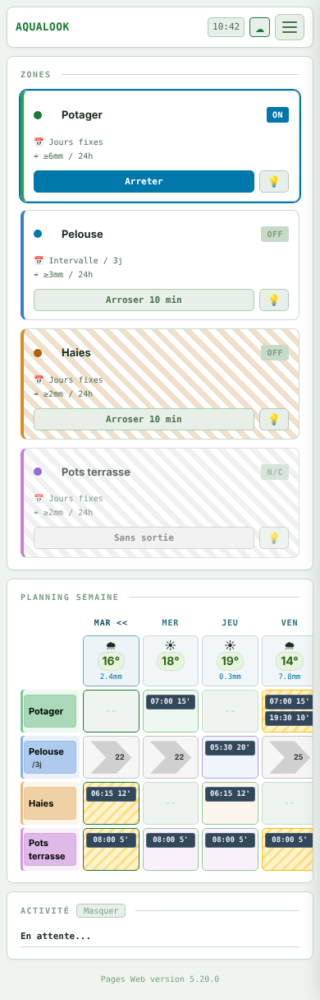

# 5. Arroser à la main

Un arrosage manuel part tout de suite, pour la **durée manuelle** réglée
(10 minutes par défaut, « Duree manuelle (min) », chapitre 3). Il ne tient
pas compte de la pluie ni du planning.

## Depuis les pages Web

Sur l'accueil, chaque tuile de zone porte un bouton :

- « Arroser 10 min » : démarre l'arrosage ;
- « Arreter » (pendant l'arrosage) : l'arrête aussitôt.

La tuile passe à « ON » pendant l'arrosage. Une zone sans vanne raccordée
affiche « Sans sortie » et son bouton est grisé.

Le petit bouton en forme d'**ampoule** ne fait pas arroser : il fait
clignoter en **blanc** la LED de la zone pendant 20 secondes, pour la
repérer sur le ruban pendant un raccordement.

*Sur téléphone : « Potager » arrose (« Arreter »), « Pots terrasse » n'a pas de vanne (« Sans sortie »).*

## Depuis l'écran du module

- **Jusqu'à 4 zones** : touchez le bouton de la zone sur l'accueil
  (« Appuyer pour arroser » / « Appuyer pour arreter »), ou ouvrez l'écran
  de la zone et touchez « Arroser 10min » / « Arreter ».
- **Plus de 4 zones** : passez à la vue « Marche forcee » et touchez la
  rangée de la zone.

Si un code PIN est posé, il est demandé avant de démarrer (chapitre 2).
Après un démarrage ou un arrêt depuis l'écran d'une zone, l'écran revient
seul à l'accueil.

## Bon à savoir

- **« Arreter » arrête aussi un arrosage programmé** en cours. Le créneau
  n'est pas rattrapé : la zone attend son prochain créneau.
- Lancer un arrosage manuel sur une zone qui arrose déjà **remplace**
  l'arrosage en cours par un arrosage manuel complet.
- **Durée maximale** : quelle que soit l'origine de l'arrosage (planning,
  main, script), aucune vanne ne reste ouverte au-delà de la « Duree max
  arrosage (min) » (60 minutes par défaut). Le module la ferme de lui-même.
- Le premier essai d'une installation se fait **toujours sur une seule
  zone, pour une durée courte, en regardant la vanne**.
